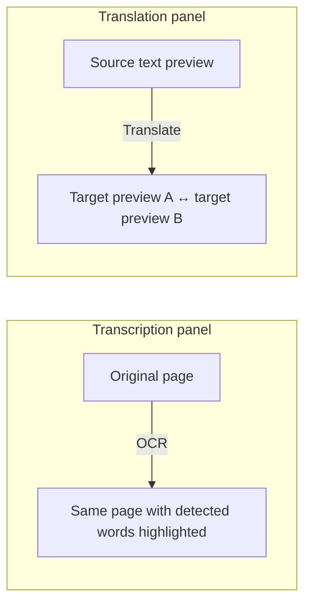

# Website fast-path roadmap

## Product flow

The website has two separate jobs:

1. **Preview and quote quickly.** Diagnose enough of the upload to show a
   credible first-page sample, word/language estimates, OCR evidence, two
   translation snippets, formats, and a price.
2. **Deliver after purchase.** Run the complete transcription/translation and
   produce the selected files. The full review workflow remains in
   `datacompiler-core` while the new delivery path is developed.

Do not make the preview path wait for complete document rebuilding or complete
translations. Do not send full pre-purchase transcripts to the browser; return
only snippets, counts, and visual box coordinates.

The post-diagnostic preview should communicate these two transformations:

## Milestones

### 0. Benchmark the diagnostic engines

**Goal:** choose an OCR path from measured results rather than architecture
preference.

- Use `datacompiler-core/tests/fixtures/polish.pdf` as the handwriting baseline.
- Add one printed scan and one native-text PDF to the comparison set.
- Compare available local OCR candidates on the Mac that hosts the tunnel. A
  reasonable first comparison is macOS Vision and PaddleOCR, with the existing
  VLM transcript as the handwriting quality reference.
- Record cold and warm first-page latency, transcription errors, language
  detection, bounding-box coverage/order, model download/startup cost, and
  memory use.
- For handwriting, decide whether OCR text itself is publishable or only its
  boxes are suitable for the animation. Keep the VLM as a text fallback when
  confidence or the benchmark requires it.

**Exit:** select a default and a fallback for each input class, with results
captured in `docs/ocr-benchmark.md`.

### 1. Build the independent diagnostic API

**Goal:** return a first-page diagnostic without importing or invoking
`datacompiler-core`'s `executer_pipeline`.

- Create a small FastAPI service in this repo; keep DeepL/OpenRouter secrets in
  the local server environment.
- Extract positioned native text directly from PDFs when available. For scans,
  run the selected OCR engine on the first page and normalize boxes to 0–1
  coordinates relative to the rendered preview.
- If a PDF exceeds 20 MiB, retain the existing confirmation flow and process
  only page one. Keep a separate hard upload limit and return whether the
  result is page-limited.
- Detect source language and count words on the server. Mark counts as
  estimates whenever not every page was analyzed.
- Translate only the first readable line into two target languages for the
  teaser. Keep all full text server-side.
- Return a job status and a compact diagnostic result. Include input size,
  candidate output-size estimates by selected format, and the calculation
  basis. Clamp reduction to 0% when estimated output is larger.
- Keep temporary jobs private, randomly identified, and time-limited.

**Exit:** contract is stable, no full-core imports, and the benchmark documents
first-page latency and accuracy for the selected OCR path.

### 2. Wire the two visual transformations

**Goal:** make the process understandable without implying that the preview is
the final file.

- Left panel: original first-page PNG → a second copy with actual OCR boxes
  outlined in fluorescent green. Animate the provider's real box granularity
  (word or line) in reading order, then restart from the top. Do not invent
  character boxes; OCR providers generally report words or lines rather than
  glyphs.
- Put a clear, restrained right-pointing arrow between the two left-panel
  images. Label it `OCR` so the transformation is clear.
- Right panel: static source-text PNG → arrow labelled `Translate` → target
  snippet PNGs. Keep the source visible; alternate two target languages every
  three seconds. Preserve equal image dimensions and blur content below the
  readable first line.
- Respect `prefers-reduced-motion`; keep a static, readable state when motion
  is disabled or box data is absent.
- A missing box map must be shown as unavailable/loading, never as a fake OCR
  success animation.

**Exit:** arrows and previews are driven by API data and remain aligned at
desktop and mobile widths.

### 3. Add multi-language and multi-format choices

**Goal:** expose real choices while keeping the closed controls readable.

- Use accessible checkbox popovers, not native multi-select boxes. Closed
  controls show selected chips or a compact summary (`English + German`,
  `PDF (text) + XLIFF`); reopened menus retain blue checked selections.
- Initially cap preview languages at two, because the right panel presents two
  target snippets. Allow more output languages later if pricing and layout
  support them.
- Default to the first two languages in `[English, French, German]` after
  excluding the source: Polish → English + French; French → English + German;
  English → French + German.
- Offer `PDF (layer)` only for handwriting transcription and default to it in
  that case. Never offer it for translation. Offer XLIFF in both panels.
- Calculate translation price from selected language count and source class;
  output format variants should not multiply the translation price unless the
  pricing model explicitly says otherwise.

**Exit:** the API receives and validates the exact selected language and format
sets, and the quote matches those selections.

### 4. Deliver full files after purchase

**Goal:** defer expensive work until there is an order.

- Connect selection and quote to the payment/order flow.
- Queue full transcription and full translations only after purchase; keep the
  preview result available while the delivery job runs.
- Produce only the requested formats and languages. Keep XLIFF as a first-class
  review/interchange file.
- Keep the current core workflow available as a fallback until the API's
  delivery outputs are verified.

**Exit:** a paid order has a durable job, clear status, exact output list, and
downloadable artifacts.

### 5. Cut over safely

- Run the new service beside the current tunneled API and compare outputs on the
  benchmark set.
- Point a non-production web build at the new API first.
- Switch the Cloudflare Tunnel only after the acceptance criteria pass; retain a
  one-step tunnel rollback to the current API.
- Remove the website-specific endpoint from `datacompiler-core` only after the
  production cutover is stable.

## Current state

- `datacompiler-web` already has the compact upload/results layout and
  single-value format/language controls.
- `datacompiler-core/main.py` still owns the live website API and currently
  invokes the complete pipeline and one complete DeepL translation.
- `datacompiler-api` now has a v1 diagnostic contract and an OCR benchmark tool.
  The native-text baseline ran on this Windows coding host; scan OCR candidates
  still need to be benchmarked on the Mac that hosts the tunnel.
- `datacompiler-api` now has an initial FastAPI diagnostic vertical slice:
  first-page rendering, native-text extraction, normalized boxes, macOS Vision
  OCR worker, optional two-language first-line translation, blurred teaser
  PNGs, and an optional word-highlight GIF. Its worker and package data are kept
  together so an installed build can locate the helper and Polish-capable font.
- The diagnostic endpoint now publishes a `preview_ready` response as soon as
  OCR and rendering finish, before waiting for the translation providers; each
  target sample is added as it completes.
- The frontend now calls the diagnostic API for scan PDFs, renders the original
  and its OCR animation beside each other, and alternates the translation PNGs.
  Native-text PDFs continue to use the existing full-processing API.
- The tunnel health and OpenAPI routes were confirmed reachable from the
  website's configured Cloudflare origin. A live `polish.pdf` diagnostic was
  accepted but remained `processing` before publishing `preview_ready`, so the
  Vision worker response protocol is being hardened before this route is ready.
- Still missing: measured scan OCR benchmark, verified output-size estimates,
  a production OCR fallback, verified live GIF generation, multi-select controls, price
  calculation for sets, and post-purchase full-output jobs.
